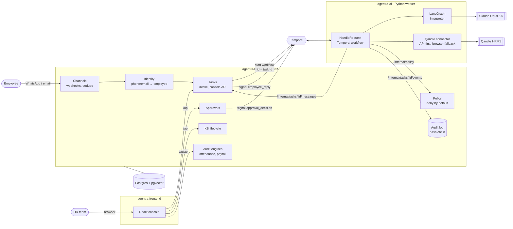
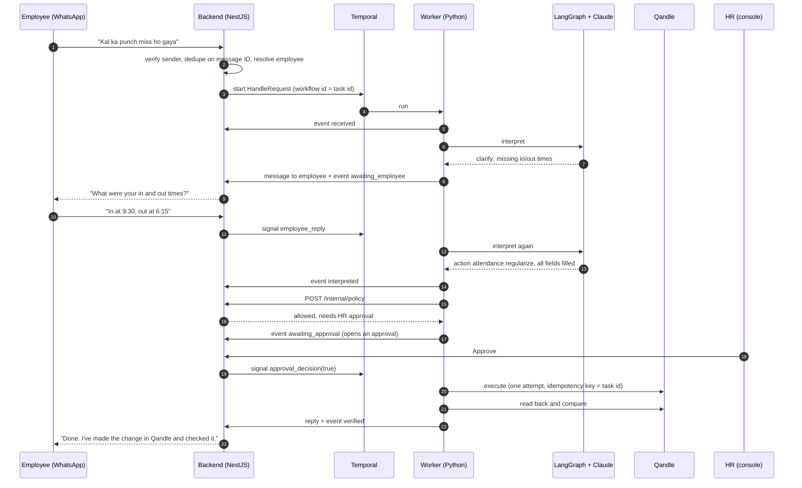

# Agentra × Assotech: Phase 1 architecture

How the HR agent is built, where each guarantee in the SOW is enforced, and the order we'll build it in. Task IDs refer to [BACKLOG.md](BACKLOG.md).

## 1. Stack

| Layer | Repo | Technology |
|---|---|---|
| Console | `agentra-frontend` | React 19 + TypeScript, Vite 8, React Router 8 (route loaders), Tailwind CSS v4 |
| System of record | `agentra-backend` | NestJS 12 (TypeScript), PostgreSQL 16 + pgvector, Drizzle ORM, Zod, Temporal TS client |
| Agent Core | `agentra-ai` | Python 3.12, Temporal (durable workflows), LangGraph (reasoning graphs), Anthropic SDK with Claude Opus 5.5, Playwright |
| Orchestration | shared | Temporal: dev server locally, Temporal Cloud or self-hosted for staging and production (INF-02) |
| Hosting | shared | AWS ap-south-1 (Mumbai): ECS Fargate, RDS Postgres, S3 + KMS, Secrets Manager, CloudFront for the console (INF-01) |

The AI repo stays in Python on purpose. LangGraph and Temporal both have mature Python SDKs, and the document-intelligence work (OCR, classification, Aadhaar masking) has far better libraries there. The two languages meet at one place: the versioned JSON Schema contracts (section 6).

## 2. System view

Who talks to whom:

- The **console** talks only to the backend.
- The **backend** never calls Qandle for agent actions, and never calls the model.
- The **AI worker** reaches the backend only through `/internal/*`, using a service token.

## 3. Repos and ownership

| Repo | Owns | Never does |
|---|---|---|
| `agentra-frontend` | The HR console: requests, request detail with the agent's timeline, approvals, needs attention, knowledge editor, audit exceptions | Call agentra-ai or Qandle directly |
| `agentra-backend` | Channels, identity, **policy**, task store, **audit log**, approvals, KB lifecycle, onboarding tracking, rule-based audit engines, Qandle data sync for audits | Call the model; take an action in Qandle on an employee's behalf |
| `agentra-ai` | `HandleRequest` workflow, LangGraph interpreter, Workflow Register in code, Qandle API and browser connectors, KB answers, document intelligence, evals | Decide permissions; write the audit log directly |

All three repos live under the client's GitHub account (`it949`). The Agent Core remains Agentra's licensed IP under SOW §11.2; the agentra-ai README records this.

## 4. One request, end to end

This exact flow already runs end to end locally. The only stub is the model step, replaced by a keyword stub because the machine had no API key. The run was **NestJS → Temporal → Python worker → NestJS**, and the audit chain verified intact afterwards.

## 5. Temporal and LangGraph: who does what

| | Temporal (`agentra-ai/workflows`) | LangGraph (`agentra-ai/graphs`) |
|---|---|---|
| Job | Durability: hours-long waits, approvals, retries, write-once execution | Reasoning: route the message, pick a template, fill its fields |
| Side effects | All of them, each one an activity | None |
| State | Workflow history; survives worker crashes and deploys | Lives for one invocation only; no checkpointer |
| Failure handling | Retries reads; **never** retries writes | Model failure or low confidence → ask the employee instead of guessing |

The interpreter graph has three possible routes:

1. **Knowledge or out of scope:** finish.
2. **Low confidence:** ask the employee a clarifying question.
3. **Action:** `fill_slots`, then `check_slots`, then either finish or ask for whatever is missing.

The model only *proposes* a template key and its field values. Code nodes then:

- check that the key is in the registry;
- take `is_write` from the registry, never from the model;
- detect missing required fields.

A graph runs inside exactly one Temporal activity, so if a worker dies mid-graph, Temporal simply reruns it. That's safe because the graph has no side effects.

## 6. Contracts

- Pydantic models in `agentra_ai.contracts` are the source of truth: `TaskRequest`, `TaskEvent`, `TaskResult`, `PolicyRequest`, `PolicyDecision`, `OutboundMessage`. They forbid extra fields.
- `scripts/export_contracts.py` writes them as JSON Schema to `contracts/v1`. A test fails if that export is stale.
- The backend vendors `contracts/v1` and generates TypeScript types from it (`npm run contracts`). Every `/internal/*` payload is validated with Ajv, and anything off-contract gets a 400.
- The console's API client will be generated from the backend's OpenAPI document at `/docs/json` (FE-04).

## 7. Where each SOW guarantee is enforced

| Guarantee | Enforced by | Status |
|---|---|---|
| The agent only does what's in the signed Workflow Register | `agentra-ai/registry` + backend allowlist (deny by default) | Draft entries; final after PRJ-01 |
| The model never decides permissions | `/internal/policy` in the backend. `is_write` comes from the registry, and the backend refuses a read/write mismatch | Built, tested |
| Employees act only on their own record | Identity resolves the employee before the workflow starts; policy refuses fields that name another employee | Built; full matrix with BE-01 |
| Risky writes need a person | Policy returns `requires_approval`; the workflow waits on a signal for 24h, then rejects | Built, tested |
| No duplicate writes | Workflow ID = task ID; unique channel message ID; write activities run once; task ID is the idempotency key | Built, tested |
| An uncertain write is never silently retried | `unknown` outcome → `unknown_outcome` status → Needs attention page | Built, tested |
| Every change is verified | Read-back `verify` activity after each write | Interface built; Qandle read-back with AI-09 |
| Complete, tamper-evident audit trail | Append-only `task_events`, SHA-256 hash chain, `/api/audit/integrity` | Built; tamper detected at the exact row in testing |
| Prompt injection can't grant approval | Employee text is wrapped as data; approval and policy live outside the model | Built; red-team suite EV-02 |
| Aadhaar never stored in full | Masked at capture in document intelligence | AI-15 |

## 8. Data model (backend)

- **`employees`:** synced from Qandle; phone and email are unique for identity.
- **`tasks`:**
  - One per request. The ID doubles as the Temporal workflow ID.
  - `request_id` is unique, so a redelivered webhook does nothing.
  - Holds the latest status.
- **`task_messages`:** the conversation in both directions.
- **`task_events`:** the append-only audit log. Each row includes `prev_hash` and `hash`. The app's database role gets INSERT and SELECT only.
- **`approvals`:** one per task. A decision is recorded once, and a second decision gets a 409.
- **To come:**
  - KB documents and versions (BE-10), with embeddings in pgvector (AI-12).
  - Synced attendance, leave and payroll inputs (BE-14).
  - Audit exceptions (BE-15, BE-16).

## 9. Environments and deployment

| | Local | Staging | Production |
|---|---|---|---|
| Postgres | Docker (`:5433`) | RDS | RDS Multi-AZ, encrypted, PITR |
| Temporal | Dev server in Docker | Temporal Cloud or self-hosted (INF-02) | Same as staging |
| Backend | `npm run start:dev` | ECS Fargate | ECS Fargate behind an ALB with WAF |
| Worker | `uv run python -m agentra_ai.worker` | ECS Fargate | ECS Fargate; browser workers sized separately |
| Console | Vite dev server, `/api` proxied | S3 + CloudFront | S3 + CloudFront |
| Qandle | Dry-run connector | Client sandbox | Client production, service account |
| Secrets | `.env` | Secrets Manager | Secrets Manager |

Each repo's CI on push runs lint, type-check, tests and build.

## 10. Execution plan

| Week | Focus | Exit criterion | Backlog |
|---|---|---|---|
| 0–1 | Discovery and foundations: Workflow Register workshops, Qandle API coverage test, AWS baseline | Register signed (D1.1); feasibility report (D1.2) | PRJ-01..06, INF-01/02 |
| 2 | Proof of concept on Qandle: login and session store, one read, one write with read-back | Witnessed PoC signed (D1.3) | AI-01..03, PRJ-07 |
| 2–3 | Agent Core hardening: real templates from the Register, Claude interpreter against the golden set, PII redaction, idempotent execute, verify, browser pool | ≥95% on the golden set; write-once proven by killing the worker mid-write | AI-05..11, BE-01..04, EV-01/02 |
| 3 | Channels: WhatsApp (Meta Cloud API), email, identity with OTP step-up, HR escalation | Test number round-trips; spoofed email rejected | BE-05..09 |
| 4 | Knowledge base and console: KB lifecycle and cited answers; console on live data, sign-in, approvals wired | HR publishes a policy and the agent cites it | BE-10..12, AI-12/13, FE-04..08 |
| 5 | Onboarding, document intelligence, helpdesk templates | Each template passes its Register acceptance test | BE-13, AI-14..17, FE-09 |
| 6 | Audit engines: Qandle sync, attendance rules, leave/payroll pre-audit | Report matches a hand-checked month | BE-14..16, FE-10 |
| 7–8 | Hardening, UAT, acceptance | No open critical defects; delivery notice (§7.4) | QA-01..03, PRJ-08..10 |

Client dependencies (SOW §9) are dated in PRJ-04. Each one blocks a named task, which is what the reciprocal delay clause (§6.4) relies on.

## 11. Built and verified today

| Repo | In place | Checks |
|---|---|---|
| agentra-ai | Workflow with clarify, policy, approval, write-once execute and verify; LangGraph interpreter on the Anthropic SDK; draft registry; contracts | 17 tests on Temporal's time-skipping server: approval, 24h expiry, uncertain write not retried, clarify loop, graph routing |
| agentra-backend | Intake with dedupe and reply routing, audit hash chain, policy, approvals → signals, internal API with contract checks, OpenAPI, migrations, seed | 13 unit tests, lint, type-check, plus the live end-to-end run |
| agentra-frontend | Console shell and all seven screens on sample data, light and dark | Lint, type-check, build, screenshots |

**Not yet real:**

- **Claude calls:** need an `ANTHROPIC_API_KEY`.
- **Qandle connector:** waiting on sandbox access.
- **WhatsApp and email:** waiting on the Meta account and the HR mailbox.
- **Console data:** still on sample data until FE-04.
- **Console sign-in:** BE-11.

## 12. Main risks

| Risk | Mitigation |
|---|---|
| Qandle has no API for some writes | Playwright flows with recorded evidence; computer-use fallback when selectors break (AI-11); per-template API-or-browser decision recorded in PRJ-02 |
| Qandle UI changes break browser flows | Selector health checks, alerting, fail-safe to `failed` (never a guessed write); runbook PRJ-09 |
| Concurrent sessions log each other out | One live session per service account, with queued access (AI-10) |
| Misread Hinglish requests | Clarify instead of guess; golden set in three languages gates releases (EV-01) |
| Prompt injection through messages or documents | Text treated as data; policy and approvals outside the model; red-team suite (EV-02) |
| Client dependencies slip | Dated dependency plan (PRJ-04) and ⛔ markers in the backlog |
| Meta business verification takes weeks | Start in week 0 (PRJ-06); email and console work meanwhile |
